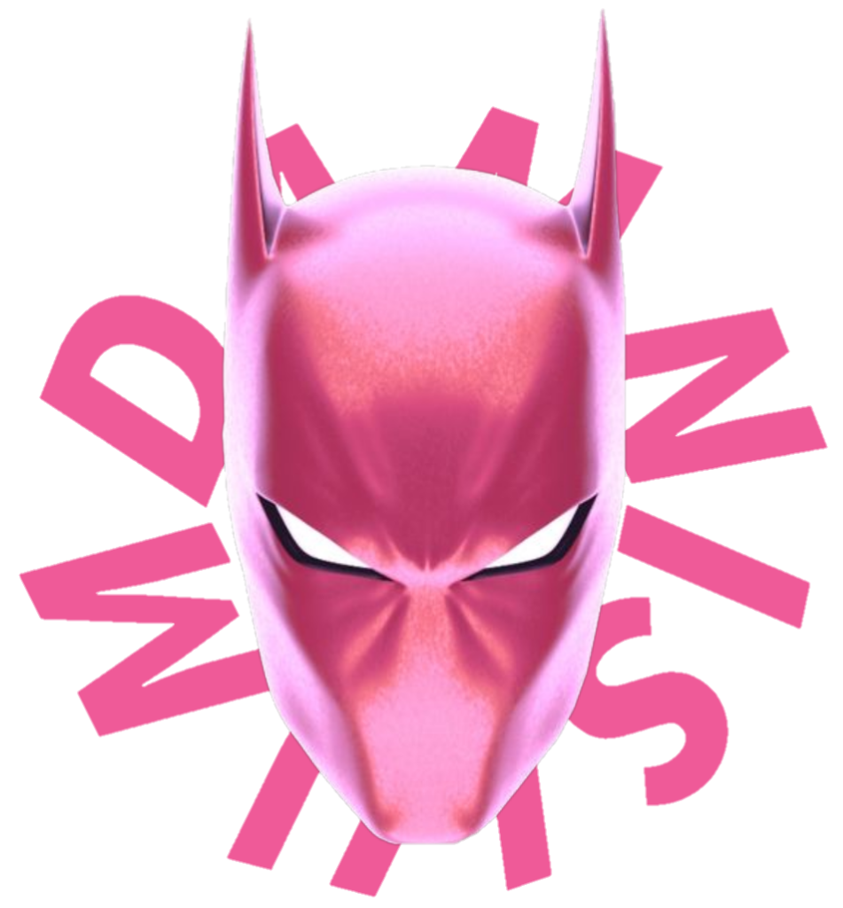
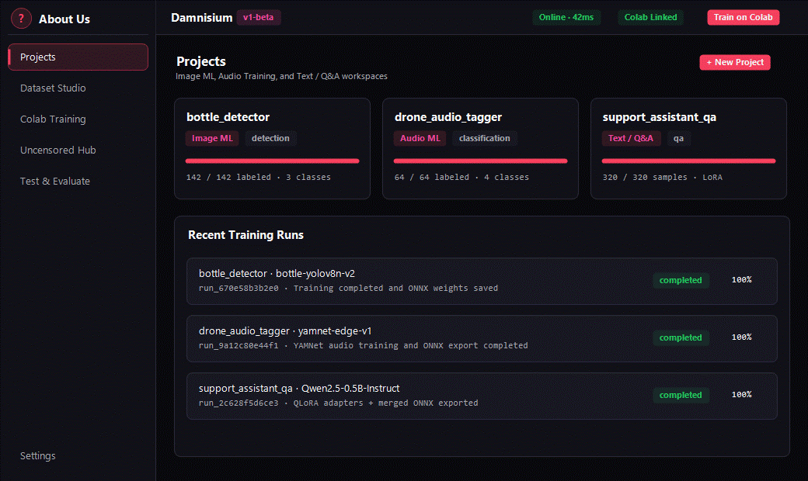

<div align="center">
  
  <h1>Damnisium</h1>
  <p>Local-first ML dataset studio, headless Google Colab GPU trainer, and ONNX / GGUF evaluation workstation.</p>

  <p>
    <a href="https://github.com/tejvx/Damnisium/releases"></a>
    
    
    <a href="LICENSE"></a>
  </p>

  
</div>

---

## What Damnisium Does

Damnisium combines dataset annotation, remote GPU fine-tuning on Google Colab, Hugging Face model discovery, and offline model testing inside a single portable desktop executable (~10.3 MB) with zero background Python install required on Windows.

- **Image ML**: Bounding-box object detection, polygon segmentation, and image classification with interactive canvas tools, ONNX Auto-Label assist (YOLOv8 / YOLO11 or your own trained ONNX weights), and live augmentation preview.
- **Audio ML**: Waveform region slicing and event tagging (YAMNet + ONNX distillation) or speech-to-text dataset preparation (Whisper Tiny / Base / Small).
- **Text / Q&A**: JSONL / CSV prompt-completion and intent classification datasets with LoRA / 4-bit QLoRA fine-tuning (Qwen2.5, SmolLM2, Dolphin Llama 3.2, DistilBERT, or custom Hugging Face repos).
- **Headless Colab Compute**: Authenticates via loopback PKCE OAuth, provisions eligible T4 / L4 / A100 Colab runtimes via the Colab REST API, streams datasets directly over Jupyter Contents HTTP, executes chunked training via Colab MCP with automatic 15s VM stall recovery, and downloads trained `.onnx` / `.pt` / `labels.json` / `metrics.json` weights locally.
- **Uncensored Hub & Local Evaluation**: Inspects Hugging Face model parameter counts and exact Safetensors/GGUF byte sizes before training or downloading, runs local inference in **Test & Evaluate** (ONNX Runtime WebGPU/WASM + `llama.cpp` server for GGUF), and exports standalone Python/Rust inference bundles.

---

## Architecture

```text
+-----------------------------------------------------------------------+
|  Tauri v2 WebView UI (TypeScript / Vite / Canvas / WebGPU ORT)        |
|  Projects | Dataset Studio | Colab Training | Uncensored Hub | Eval   |
+-----------------------------------+-----------------------------------+
                                    | Tauri IPC Commands & Events
+-----------------------------------v-----------------------------------+
|  Rust Core (src-tauri/src)                                            |
|  - storage.rs       Local projects, splits, ZIP packaging, preflight  |
|  - google_oauth.rs  Loopback PKCE OAuth + token refresh               |
|  - colab_api.rs     Colab REST runtime lifecycle, Jupyter I/O, MCP    |
|  - colab_notebook.rs Headless stage builder & .ipynb generator        |
|  - training.rs      15s stall auto-restart, streaming logs & metrics  |
|  - hf_hub.rs        HF API telemetry, byte sizing & streaming fetch   |
|  - gguf_runtime.rs  Managed local llama-server process for GGUF chat  |
+-----------------------------------------------------------------------+
```

---

## Quick Start

### Standalone Portable Binary

1. Download **`Damnisium.exe`** and **`launch.bat`** from the [Releases](https://github.com/tejvx/Damnisium/releases) page (or run them directly from the repository root).
2. Double-click `Damnisium.exe` or `launch.bat`.
3. Project files, annotations, downloaded GGUFs, and trained weights are stored locally in `./damnisium-data/`.

### Build from Source

**Prerequisites:** Rust (`stable-x86_64-pc-windows-msvc`), Node.js 20+, and `pnpm`.

```powershell
pnpm install
pnpm run build
pnpm exec tauri build --no-bundle
```

To generate the portable `Damnisium.exe` at the repo root:

```powershell
powershell -ExecutionPolicy Bypass -File scripts/pack-portable.ps1
```

---

## Google Colab Setup

1. Open **Settings** in Damnisium and click **Sign in with Google** to authorize your Google account for Colab runtime access (`colaboratory` + `userinfo.email` scopes via PKCE loopback).
2. Optional **Drive Checkpoint Backup** can be enabled in Settings to mirror finished weights into Google Drive.
3. To route billing or quota through your own Google Cloud project, expand **Advanced Colab & OAuth Override** in Settings and provide your OAuth Client ID / Secret and GCP Project Number (`x-goog-user-project`). Ensure the `colaboratory.googleapis.com` API is enabled on that project.

---

## Repository Layout

| Path | Purpose |
| --- | --- |
| `src/` | TypeScript frontend studios, charts, Colab live console, and ONNX WebGPU evaluator |
| `src-tauri/src/` | Rust backend: storage, OAuth PKCE, Colab REST/MCP client, HF Hub client, training orchestrator |
| `public/assets/` | Application icons and static web assets |
| `scripts/` | Build scripts (`pack-portable.ps1`, `sync-ort.mjs`) |
| `Damnisium.exe` | Prebuilt standalone Windows x64 portable executable |
| `launch.bat` | One-click Windows launcher |

---

## License

MIT License — see [LICENSE](LICENSE).
